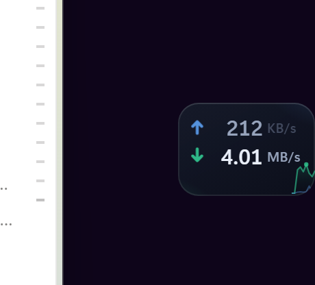

<div align="center">

# Net HUD

**An elegant always-on-top network speed widget for Windows.**

A small translucent glass card that floats at the edge of your screen and shows one thing:
**how fast your network is going right now** — download and upload.

[](LICENSE)




<sub>100×68 DIP card · upload on top, download below · the unit brightens as the speed tier rises</sub>

**[中文说明 (Chinese README)](README.zh-CN.md)**

</div>

---

## Why another network widget?

Windows has no built-in floating network meter, and the tools that do exist are either
embedded in the taskbar (so the taskbar hides or covers them), or heavy, or ugly.
Net HUD is:

- **A real floating card, not a taskbar item.** No window chrome, truly transparent,
  always on top, never steals focus. Pixels outside the rounded rectangle do not even
  catch the mouse.
- **Resident.** Starts at login, restarts itself within ~2 seconds if it ever dies, and
  depends on nothing else — no companion app, no runtime to install.
- **Small and quiet.** 100×68 DIP at 100% scale (0.8×–1.6× available). Measured on the
  development machine: **0.65% of the whole CPU while idle**, ~190 MB private memory
  in total.
- **Honest numbers.** The sampler reads `NetworkInterface.GetIPStatistics()` — the same
  counters Task Manager uses — and was cross-checked against `Get-NetAdapterStatistics()`.
- **Bilingual UI** (English / 中文) that follows the system language and can be switched
  at runtime.

## Features

| | |
|---|---|
| **Live download / upload** | Upload on top, download below. Updates every 0.5–5 s (configurable). |
| **Pinned arrows** | The ↓/↑ marker sits at a fixed spot near the left edge; digits grow leftward, the unit column never moves. |
| **Speed-tier units** | `B/s` → `KB/s` → `MB/s` → `GB/s` get progressively brighter and bolder, so a glance tells you the magnitude. |
| **Trend sparkline** | The last ~48 samples drawn behind the numbers (optional). |
| **Edge snapping** | Drag it anywhere; on release it snaps to the nearest screen edge. |
| **Click-through mode** | Make the card completely transparent to the mouse (`Ctrl+Alt+C` to release). |
| **Themes** | Follow system, dark, or light. |
| **Bytes or bits** | `B/s` (like Task Manager) or `bit/s` (like ISP ratings). |
| **Per-interface** | All interfaces, or one specific adapter. |
| **Start at login** | A real toggle in the menu — see below. |
| **Tray + hotkeys** | `Ctrl+Alt+N` show/hide, `Ctrl+Alt+C` click-through, `Ctrl+Alt+S` snap right. |

## Install

### Option 1 — installer (recommended)

1. Download `NetHUD-Setup-x.y.z.exe` from [Releases](../../releases).
2. Run it. It installs per-user to `%LOCALAPPDATA%\Programs\Net HUD` (no admin needed),
   registers start-at-login, and launches the widget.
3. Uninstall from *Apps & features*, or with the uninstaller in the install folder.

### Option 2 — from source

```powershell
git clone https://github.com/sonshpx-code/Elegant-Internet-Speed-Display-Widget---Windows.git
cd Elegant-Internet-Speed-Display-Widget---Windows

# 1. build the two tiny native helpers (uses the csc.exe that ships with Windows)
pwsh -File tools/build-sampler.ps1

# 2. get Electron
cd hud-app; pnpm install; node node_modules/electron/install.js; cd ..

# 3. register start-at-login + Start Menu shortcut, and launch it
pwsh -File tools/install.ps1
```

`tools/install.ps1 -Status | -Stop | -Start | -Uninstall` manage the resident install.

> Having the packaged app and the source build installed at the same time is harmless —
> the single-instance lock makes the second one step aside. Pick one for start-at-login.

## Usage

- **Left-drag** the card to move it (it snaps to the nearest edge on release).
- **Right-click** the card or the tray icon for the menu: unit, refresh interval,
  interface, size, theme, language, sparkline, always-on-top, lock position,
  start at login, click-through, edge snapping, about, quit.
- **Double-click** the tray icon to show/hide.
- `Quit` only stops it until the next login. To stop it permanently, uninstall it (or
  untick *Start at login*).

### Start at login — and why there are two mechanisms

Tick **Start at login** in the menu and Net HUD launches itself when you log in.
Under the hood it uses, in this order:

1. **A scheduled task** (`NetSpeedHud`, logon trigger) — visible and controllable in
   *Task Scheduler*.
2. **A registry Run key** (`HKCU\...\CurrentVersion\Run\NetHUD`) — the fallback.

The fallback is not decoration. On a restricted token (managed or sandboxed sessions),
`schtasks /Create` **and** PowerShell's `Register-ScheduledTask` both return
`Access is denied`, while a per-user Run key writes fine. A non-admin user should not
lose start-at-login because of that. The menu checkbox reflects the real state of both
and is re-read every time the menu opens.

## How it works

```
  Scheduled task / Run key  (at logon)
        │
        ▼
  net-hud-watchdog.exe   ── native, ~14 KB, no runtime
        │  spawns, waits, decides whether to restart
        │  · crash            → restart with backoff (2/4/8/16/30 s, max 5, counter resets after 60 s stable)
        │  · user quit        → consumes <state>\quit and stays down
        │  · already running  → probes the loopback lock port and steps aside
        │  · electron missing → retries every 5 min for an hour (a broken install should heal itself)
        ▼
  Net HUD.exe (Electron window)
        │  transparent, frameless, always-on-top, never focused
        │  cursor polled for an exact rounded-rect hit test → setIgnoreMouseEvents
        └─ netspeed-sampler.exe   ── 8 KB native, one JSON line per interval
```

| Path | What it is |
|---|---|
| `hud-app/main.js` | Window lifecycle, edge snapping, dragging, hit testing, tray, hotkeys, prefs, sampler supervision, single-instance lock, autostart toggle |
| `hud-app/renderer/net.{css,js}` | All of the card's visuals and motion |
| `hud-app/i18n.js` | UI strings (English + Chinese), shared by the main process and the renderer |
| `hud-app/src/netspeed-sampler.cs` | Network sampler → `bin/netspeed-sampler.exe` |
| `hud-app/src/net-hud-watchdog.cs` | Supervisor → `bin/net-hud-watchdog.exe` |
| `tools/install.ps1` | Resident install for the source build |
| `tools/measure.ps1` | Honest CPU/memory measurement (see below) |
| `hud-app/build/installer.nsh` | NSIS hooks: register/unregister start-at-login on install/uninstall |
| `lib/host.js`, `cordis.patch.yml` | **Optional** DSH plugin wrapper — the widget does not need it |

### Why a native sampler instead of pure JavaScript

Electron/Node cannot read interface byte counters — `os.networkInterfaces()` gives
addresses and link state, not traffic. So an 8 KB native helper reads
`NetworkInterface.GetIPStatistics()` and writes one JSON line per interval to stdout,
which the window process spawns and parses. It needs **no** runtime and no install
step: `csc.exe` ships with Windows.

## Performance

Measured with [`tools/measure.ps1`](tools/measure.ps1) on the development machine
(Windows 11 25H2, 20 logical cores, 200% display scaling, no discrete GPU):

| Scenario | CPU (of one core) | CPU (of the machine) | Private memory |
|---|---|---|---|
| Idle | 13.1% | **0.65%** | 188 MB across 6 processes |
| Downloading (animations active) | 17.2% | **0.86%** | 191 MB |

The first version cost **~30% of a core** — for a card that changes twice a second. Two
findings fixed that, both from measuring instead of guessing:

1. **An infinite CSS animation on a machine without GPU compositing means 60 fps of
   software repaints.** The arrows used to "breathe" via `@keyframes ... infinite`; the
   renderer and GPU process alone ate ~18% of a core. That is now driven by JavaScript
   at 4 Hz (~1/15 the repaints, same look), letting the compositor go idle.
2. **Cursor polling sent an IPC message on every tick** (12.5/s, changed or not). It now
   messages only on change, polls at 40 Hz near the card and 6.7 Hz when the pointer is
   elsewhere, and stops entirely in click-through mode or while hidden.

Enabling hardware acceleration was tried and **rejected**: this machine's "GPU" is
software-emulated, so Chromium fell back to SwiftShader and the cost went *up*
(47% of a core, +60 MB). Use `--net-gpu` on machines with a real GPU.

Memory is reported as the **private** working set: shared Chromium code pages are counted
once per process in the usual working-set figure, which would double-count them.

## Verification

This project is written to be provable, not just plausible. What was measured, and what
it caught:

| Claim | Evidence |
|---|---|
| Numbers match the OS | Sampler vs `Get-NetAdapterStatistics()`, identical byte counts; `tools/probe-sample.js` prints the raw bytes/s reaching the renderer |
| No flicker | `window.__netStats()`: with a constant-value sampler, `frames` grows while `writes` stays 0 (`tools/probe-churn.js`) |
| Never steals focus | A real synthetic click on the card; the foreground window does not change (`tools/probe-window.ps1`) |
| Click-through is exact | The hit test flips `WS_EX_TRANSPARENT`: `0x8080008` over the card, `0x8080028` away from it |
| Crash recovery | Kill the window → the watchdog restarts it in **2 s** |
| User quit is respected | Write the `quit` marker, kill the window → the watchdog consumes the marker and stays down |
| One instance only | A second launch probes the loopback lock port and exits 0 without spawning a window |
| Resident without any host | Process chain is `svchost.exe (Task Scheduler) → net-hud-watchdog.exe → electron.exe` |

Bugs this process caught (all by running the thing, not by reading it):

- A `ReferenceError` in the sample path popped a **modal** Electron error box, blocking
  the app with nothing in the log. Fixed, plus `uncaughtException` logging.
- A scheduled task's own "restart on failure" **does not** restart a force-killed process
  (measured: 130 s, nothing happened) — hence the dedicated watchdog.
- A PID file for single-instance detection **lied**: Windows reused the PID for
  `LockApp.exe`, so the widget decided it was already running and exited silently on every
  launch. Replaced with a loopback port lock.
- `ELECTRON_RUN_AS_NODE` in the environment makes the app start as plain Node and reject
  every switch. The watchdog strips it before spawning — and, for that reason, the
  installer never relies on running the Electron binary to register itself.
- `pnpm add` re-resolved Electron and skipped its postinstall, deleting the binary; the
  widget stayed dead until `node node_modules/electron/install.js` was re-run. The
  watchdog now retries a missing binary for an hour instead of giving up after 5 tries.

## Platform notes

Windows 10/11 only. The interesting constraints, all learned the hard way:

- Chromium's `--user-data-dir` / `--disk-cache-dir` / `--crash-dumps-dir` are redirected
  into the state folder; never assume the install directory is writable.
- Do **not** use `requestSingleInstanceLock()`: it creates a lock under `userData`, and
  when that directory is not writable the process dies instead of returning `false`.
- `--no-sandbox` has to be on the command line (in sandboxed hosts the Chromium sandbox
  fails before any JavaScript runs).
- Nothing may be started with inherited piped stdio: Electron's renderer fails to load.
- Layered (per-pixel transparent) windows are invisible to GDI screen capture, so
  screenshots are taken by the window itself (`--net-snapshot=`).
- Every `.ps1` in this repo is UTF-8 **with BOM**: Windows PowerShell 5.1 reads it as ANSI
  otherwise and can fail to parse the file entirely.

## Development

```powershell
pwsh -File tools/dev-net-hud.ps1                       # run a dev instance (separate state dir)
pwsh -File tools/dev-net-hud.ps1 -Kill                 # stop dev + resident instances
pwsh -File tools/probe-window.ps1                      # hit test, focus test, geometry
pwsh -File tools/measure.ps1 -Seconds 60               # CPU / memory
pwsh -File tools/dev-net-hud.ps1 -Shot ..\docs\shot.png -Delay 6000   # window self-snapshot
```

Source comments and the Chinese README are in Chinese; the UI, this README and all log
lines are English.

## License

[MIT](LICENSE) © 2026 sonshpx-code

Not affiliated with Microsoft. "Windows" is a trademark of Microsoft Corporation.
