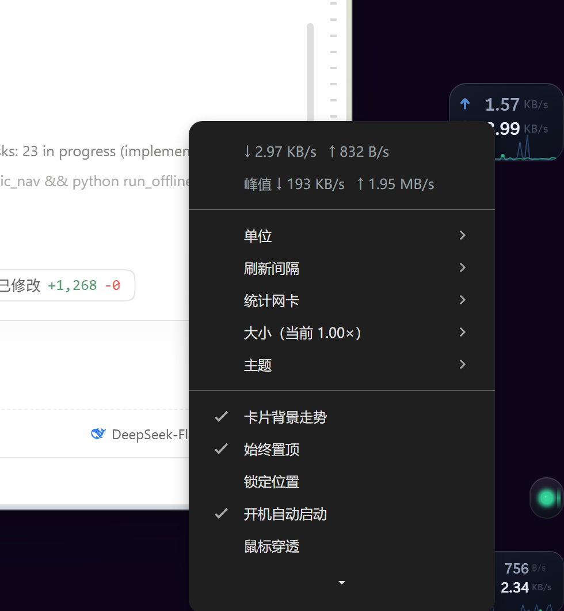

# 网速悬浮组件 · Net HUD

> **English README → [README.md](README.md)**（英文版是面向开源发布的主文档，更新更及时）
>
> 这份中文文档是**开发过程记录**：架构、平台约束、性能实测、验证方法与踩过的坑都在里面，
> 读起来比英文版详细。但它的部分细节停留在打包发行之前 —— 例如卡片尺寸、自启机制的
> 最新实现（计划任务 + Run 键兜底）、英文界面等，以英文版和源码注释为准。

贴着屏幕边缘悬浮的一小块玻璃卡片，只说一件事：**现在下行多快、上行多快**。

**它是常驻的**：登录自启、异常退出自动回来，**不依赖 DSH**——DSH 开不开、装没装，它都在。
（视觉与技术栈沿用 `dsh-status-hud` 那一套：独立 Electron 透明窗口 + 同一套设计令牌；
DSH 插件那半边仍然保留，但只是可选项，用来在你开着 DSH 时也能从插件面板里启停它。）


- **100×68 的卡片**（缩放 0.8–1.6×）：**上行在上、下行在下**。
  - 箭头是 SVG（描边 2px，比 ↓↑ 字形明显），**位置钉死在行的最左边**，不随数字位数移动——
    试过让它贴着数字走，结果每变一次位数箭头就横向挪一下，读起来是抖的；宁可留一点空隙换稳定。
  - 数值占满中间、右对齐顶着单位列：位数变化时只有它的左端在动，箭头和单位都不动。
  - **单位随速度档位变亮**：`B/s` 最淡 → `KB/s` 稍亮 → `MB/s` 起明显 → `GB/s` 最亮。
    透明度、颜色、字重三件事一起拉开（只调透明度在这个字号下几乎看不出来）；
    一行是慢是快，单位已经在说了，不必再为每个数值单独造颜色。
- **开机自动启动是一个开关**（右键菜单里勾选，见第三节）：勾上就是登录时自动拉起，
  点掉就只是这次开着、下次登录不会自己起来。状态读的是计划任务的真实启用状态，不是缓存。
- 贴右边缘、竖直居中，可拖到任意位置后自动吸附贴边。
- **无边框、真透明、始终置顶、永不抢焦点**；圆角之外的像素不挡鼠标。
- **不会闪**：内容签名没变就不写 DOM，这条有可断言的回归探针（见第六节）。
- **不会被任务栏压住**：窗口矩形永远夹在工作区内，任务栏自动隐藏时另外留出底部余量。

---

## 一、它由两块组成（外加一个可选的 DSH 插件）

```
        ┌────────────────────────────────────────────┐
        │ 计划任务 NetSpeedHud（登录时启动看门狗）     │   动作 = net-hud-watchdog.exe
        └───────────────────┬────────────────────────┘
                            ▼
        ┌────────────────────────────────────────────┐
        │ bin/net-hud-watchdog.exe（8KB，常驻）        │   父进程是 svchost，不是 DSH
        │  · 拉起窗口、等它退出、按语义决定是否重来      │   实测崩溃后 2 秒恢复
        │  · 用户退出（quit 标记）就不再来              │
        └───────────────────┬────────────────────────┘
                            ▼
        ┌────────────────────────────────────────────┐
        │ hud-app（独立 Electron 窗口，自带运行时）    │
        │  · 透明置顶卡片、贴边、拖动                  │
        │  · 光标命中测试 → 鼠标穿透                   │
        │  · 托盘菜单 / 快捷键 / 偏好文件 / 单实例判断  │
        │  └─ bin/netspeed-sampler.exe                │  每秒一行 JSON
        └────────────────────────────────────────────┘
```

| 路径 | 作用 |
|---|---|
| `hud-app/src/net-hud-watchdog.cs` → `bin/net-hud-watchdog.exe` | 常驻看门狗：拉起并监管窗口（登录自启的真正入口） |
| `hud-app/main.js` | 窗口生命周期、贴边、拖动、光标命中测试、托盘、快捷键、偏好文件、采样器监管、单实例判断 |
| `hud-app/preload.js` | 渲染进程唯一的对外通道（`window.netHud`） |
| `hud-app/renderer/net.{html,css,js}` | 卡片的全部视觉与动效 |
| `hud-app/src/netspeed-sampler.cs` → `bin/netspeed-sampler.exe` | 网卡速率采样器（8KB，系统自带编译器编译） |
| `tools/install.ps1` | 常驻安装：计划任务 + 开始菜单快捷方式 |
| `tools/` 其余 | 构建、开发启动、探针、自拍合成（见第六节） |
| `package.json` · `cordis.patch.yml` · `lib/host.js` | **可选**的 DSH 插件包（同一套监管逻辑的另一条入口，默认不装） |

**为什么还需要一个看门狗**（而不是让计划任务直接起窗口）：计划任务自带「失败后重启」，
但实测**对“进程被强杀”不生效**——杀掉窗口后任务只是结束，`LastTaskResult=0xFFFFFFFF`，
一直没重拉。所以监管交给这个 8KB 的小程序（语义与 `lib/host.js` 完全一致），
实测崩溃后 **2 秒**恢复；计划任务只负责「登录时把看门狗拉起来」，那条路它很可靠。

**为什么需要一个采样器**：Electron / Node 没有读取网卡字节计数的 API
（`os.networkInterfaces()` 只有地址和状态，没有流量）。所以用一个 8KB 的原生小程序读
`NetworkInterface.GetIPStatistics()`，按间隔把 JSON 行写到 stdout，窗口进程 spawn 并逐行解析。
它不需要任何运行时或安装步骤：`csc.exe` 是 Windows 自带的。

---

## 二、形态与交互

| 操作 | 效果 |
|---|---|
| 左键拖动 | 移动；松手时离左右边 ≤ 72px 就吸附贴边，否则留在原地（位置写进 `prefs.json`） |
| 右键 | 卡片菜单：单位 / 刷新间隔 / 统计网卡 / 大小 / 主题 / 走势 / 置顶 / 锁定 / 穿透 / 贴边 / 关于 / 退出 |
| 托盘图标 | 左键显示或隐藏，右键同一个菜单；悬停显示当前、峰值、本次累计。**新图标默认落在"隐藏的图标"里**（Windows 对每个新程序都这样），把它拖到任务栏可见区即可常驻 |
| `Ctrl+Alt+N` | 显示 / 隐藏 |
| `Ctrl+Alt+C` | 切换全窗鼠标穿透（穿透后菜单只能从托盘打开，这是刻意的逃生口） |
| `Ctrl+Alt+S` | 贴到右边缘 / 取消贴边 |

**单位**：`B/s`（同任务管理器）或 `bit/s`（同宽带标称）。100M 宽带满速约 12.5 MB/s = 100 Mbit/s。

**统计网卡**：默认统计全部物理网卡（自动排除回环与隧道）；VPN 会重复计数，所以在菜单里
可以把统计范围收到具体某一张网卡。菜单里的网卡列表来自采样器的实时输出，拔插网卡会自动更新。

**贴边悬浮，不抢焦点**：

- 窗口用 `focusable: false` 创建（Windows 上即 `WS_EX_NOACTIVATE`），每次显示都是 `showInactive()`。
- 透明像素不是死区：主进程每 80ms 读一次光标，对**可见的圆角矩形**做精确命中测试，
  据此翻转 `setIgnoreMouseEvents`。不用 `forward: true`——它在部分宿主上收不到指针回来的事件，
  策略就永远翻不回去，组件会变成永久点不到。
- 窗口矩形夹在工作区内，`screen-saver` 层级置顶；显示器工作区变化时重新夹一次。

---

## 三、安装（常驻）

```powershell
# 一步到位：编译采样器 / 生成图标（缺什么补什么）+ 注册计划任务 + 建开始菜单快捷方式 + 立刻启动
pwsh -File tools/install.ps1

pwsh -File tools/install.ps1 -Status      # 任务状态、进程归属、路径一览
pwsh -File tools/install.ps1 -Stop        # 停下（登录后还会起来）
pwsh -File tools/install.ps1 -Start
pwsh -File tools/install.ps1 -Restart
pwsh -File tools/install.ps1 -Uninstall   # 停掉 + 删任务 + 删快捷方式
```

**为什么用计划任务而不是注册表 Run 键**：

- 它自带「失败后重启」（失败 1 分钟后重试，最多 3 次）——窗口崩了会自己回来；
  而用户主动「退出」是退出码 0，任务算成功完成、不会把它拉起来，这才是对的语义。
- 触发器是「登录时」+「交互式主体」，所以运行在你的会话里，窗口能正常显示
  （不是会话 0 的服务）。实测主进程的父进程是 `svchost.exe`（任务计划服务），**不是 DSH**。
- **开关就是一个任务状态**：右键菜单里的「开机自动启动」= 启用/禁用这个任务，
  读到的是操作系统里的真实状态（不是应用自己的缓存），也可以随时从「任务计划程序」里看。
- 卸载是一条命令。

### 开机自动启动开关

右键卡片（或托盘图标）→ **开机自动启动**：



| 勾选状态 | 实际发生的事 |
|---|---|
| ✅ 勾上 | 计划任务 `NetSpeedHud` 启用：登录时自动拉起看门狗 → 窗口 |
| ⬜ 点掉 | 任务禁用：**这次还开着，下次登录不会自己起来**；开始菜单快捷方式仍可手动开 |

实现上只用了 `schtasks`（自带命令，毫秒级）：

- 读状态 `schtasks /Query /TN NetSpeedHud /XML` —— 任务被禁用时 XML 里才会出现
  `<Enabled>false</Enabled>`，没有这个元素就是启用。这条规则**与系统语言无关**；
  换成 PowerShell 的 `Get-ScheduledTask` 在这台机器上要 **3.7 秒**，菜单等不起（实测）。
  另外 schtasks 的输出可能是 UTF-16，去掉 NUL 之后 ASCII 标签才能匹配上。
- 切换 `schtasks /Change /TN NetSpeedHud /ENABLE|/DISABLE`，失败会弹框告诉你原因。
- 每次菜单弹出前都重新读一次，所以勾永远是真实状态；菜单项在没装计划任务时会变成
  灰色的「开机自动启动（未安装计划任务）」，而不是骗你说已经开了。

**运行时是自带的**：`hud-app/node_modules` 里有一份完整的 Electron（安装时
`pnpm install` + `node node_modules/electron/install.js` 得到，约 270MB）。
不借用兄弟项目、不依赖 DSH、不需要系统里有 Node。

窗口自己的偏好在 `hud-app/.state/prefs.json`；日志在同目录的 `net-hud-app.log`。
组件自带单实例判断（回环端口锁）：计划任务、开始菜单快捷方式、DSH 插件
三方同时想拉起它时，第二份会安静退出，不会出现两个卡片。
（开发时想让第二个实例起来，加 `--net-allow-multi=1`；`tools/dev-net-hud.ps1` 会自动加。）

### 可选：DSH 插件集成

想把「网速组件」也挂进 DSH（从插件面板里启停），仍然可以：

```powershell
pwsh -File tools/setup.ps1
pwsh -File tools/setup.ps1 -RegisterBundle     # 改 profile 前先备份，写完立刻回读校验
pwsh -File tools/setup.ps1 -Unregister         # 一条命令摘掉
```

`desktop` 是 live 配置，注册后 4 秒内就会挂载并拉起窗口。它的配置在
`~/.dsh/net-hud/plugin.json`（`autoLaunch` 设成 `false` 可以让它只监管不启动）。
**注意**：装了插件又装了计划任务时，两边都会尝试启动窗口，靠组件自己的单实例判断去重——
先起来的那个活着，后起来的那个退出（退出码 0，计划任务不会重试）。

---

## 四、平台约束（照抄自状态组件，都是踩出来的）

1. **Chromium 目录必须重定向**（`--user-data-dir` / `--disk-cache-dir` / `--crash-dumps-dir`）。
   被 harness 启动的进程被限制在会话工作区内，而 Electron 启动时要用 `%APPDATA%`、`%TEMP%`、
   `~/.dsh`（crashpad、HTTP 缓存、ProcessSingleton 锁），被拒之后它不是降级而是直接死。
   常驻路径没有这个限制，但两条入口共用同一套参数，行为才一致。
2. **不用 `requestSingleInstanceLock()`**：它要在 `userData` 下建锁，目录不可写时会把进程
   直接干掉而不是返回 `false`。单实例判断改用**回环端口**（48711，对面回一句 `net-hud` 才算数）：
   内核维护归属，进程一死端口立刻释放，不存在过期状态。
   **PID 文件会撒谎**——进程退出后 Windows 会把 PID 复用给别的进程，实测 pid 文件里的 20188
   后来变成了 `LockApp.exe`，于是每次启动都误判“已经有一份在跑”并安静退出。
   PID 文件现在只作排查用的便利文件。
3. **`--no-sandbox` 必须在命令行上**：本机 Chromium 沙箱初始化不了，Electron 在任何 JS 执行
   之前就以 `STATUS_BREAKPOINT` 死掉，`app.commandLine.appendSwitch` 根本来不及跑。
4. **`ELECTRON_RUN_AS_NODE` 必须从子进程环境里删掉**：DSH 宿主自己就是 Electron 的 Node 模式，
   环境里带着它（本机实测 `=1`），继承下去窗口会以纯 Node 启动并立刻死在 `require('electron')`。
5. **`.ps1` 一律带 UTF-8 BOM**：PowerShell 5.1 会把没有 BOM 的非 ASCII 当 ANSI 解码，
   落在字符串字面量里可能产出破坏引号配对的字节序列，**整个脚本解析失败且几乎没有输出**。
6. **不要把窗口挂在继承的管道 stdio 上启动**（`& $electron @args` 那种）：那个调用方式下渲染
   进程的加载会失败。一律 `Start-Process` 配 `-RedirectStandardOutput/-Error`；插件用的是 Node
   `spawn` + `stdio: 'ignore'`。
7. **分层窗口抓不到屏**：组件是逐像素透明的分层窗口，GDI 的 `BitBlt`（`CopyFromScreen`）
   **不会**合成它。所以验证走窗口自拍（`--net-snapshot=`），再用 `tools/preview.ps1` 贴回桌面截图。

---

## 五、数据来源与精度

- 每个网卡取 `NetworkInterface.GetIPStatistics()`（该网卡 IPv4+IPv6 总字节数），
  采样器用 `Stopwatch` 算真实经过时间求差分；计数器回绕/重置时不取负值。
- **与系统计数器对拍一致**（同一秒，多次采样）：

  | 系统 `Get-NetAdapterStatistics` 增量 | 采样器输出 |
  |---|---|
  | rx=27,834,923  tx=71,230 | rx=17.6M→20.6M  tx=105K→44K（窗口错位一格） |
  | rx=103,454  tx=10,246 | rx=100,751  tx=9,978 |
  | rx=16,176  tx=5,834,605 | rx=15,831  tx=5,710,282 |

  最后一行那个 5.8MB/s 的上行是机器上真实存在的流量，不是组件算错——这也是为什么它值得对拍。
- 峰值与本次累计只统计程序启动之后的数据；网卡选择变化时累计会重置。

---

## 六、验证矩阵

每条结论都有两层证据：逻辑层（探针/表达式）与表现层（真实窗口自拍）。

| 断言 | 证据 |
|---|---|
| 数值与系统计数器一致 | ✅ 上表对拍；另有 `tools/probe-sample.js` 报出渲染端收到的原始字节/秒（`rawRx_bps=26,433,299 → 显示 25.2 MB/s`） |
| **崩溃后自动恢复** | ✅ 杀掉窗口主进程 → 看门狗 **2 秒**拉起（`watchdog.log` 有 `窗口退出 code=-1 … 2000ms 后第 1 次拉起`） |
| **用户退出后不再拉起** | ✅ 写 `quit` 标记再杀窗口 → 看门狗消费标记并结束，进程数归 0 |
| **与 DSH 无关** | ✅ 进程链 `svchost.exe（任务计划）→ net-hud-watchdog.exe → electron.exe` |
| **重复启动不会出两张卡** | ✅ 再启一份看门狗：探测到锁端口有应答，立刻退出（码 0），窗口进程数不变 |
| **数值没变就不重画 DOM**（闪烁回归） | ✅ `tools/probe-churn.js` + 恒定值假采样器：`frames 4→9, writes 7→7, verdict PASS` |
| **点击不抢焦点** | ✅ `tools/probe-window.ps1` 真实光标 + 真实点击：前台窗口未变 |
| **命中测试翻转鼠标策略** | ✅ 卡上 `ExStyle=0x8080008`（可交互）、卡外 `0x8080028`（穿透） |
| **窗口贴边且尺寸正确** | ✅ `GetWindowRect`：304×136（=152×68 @200%），右边缘贴齐 2880 |
| 两种主题 / 两种单位 | ✅ `docs/preview-03.png`（深色 B/s）、`docs/preview-light.png`（浅色 bit/s） |
| 自拍合成 | ✅ `tools/preview.ps1`（把自拍按真实位置贴回桌面抓屏） |

```powershell
# 常驻安装 / 卸载 / 状态
pwsh -File tools/install.ps1
pwsh -File tools/install.ps1 -Status
pwsh -File tools/install.ps1 -Stop        # 停（登录后还会起来）
pwsh -File tools/install.ps1 -Uninstall   # 彻底不启动

# 常驻窗口 + 探针（开发用，不动计划任务）
pwsh -File tools/dev-net-hud.ps1                       # 起一个
pwsh -File tools/probe-window.ps1                      # 命中测试 + 不抢焦点
pwsh -File tools/probe-window.ps1 -Measure             # 只读矩形与样式

# 闪烁回归（恒定样本：frames 必须涨、writes 必须不动）
pwsh -File tools/build-sampler.ps1
pwsh -File tools/dev-net-hud.ps1 -Sampler 'bin\fake-sampler.exe' `
     -EvalFile 'tools\probe-churn.js' -EvalDelay 2500

# 自拍 + 合成（分层窗口抓不到屏，必须让窗口自己拍）
pwsh -File tools/dev-net-hud.ps1 -Shot docs\shot.png -Delay 20000
pwsh -File tools/preview.ps1 -Shot docs\shot.png -Out docs\preview.png
pwsh -File tools/dev-net-hud.ps1 -Theme light -Unit bits -Shot docs\shot-light.png
# 注意：-Theme/-Unit 会写进那份 state 的 prefs.json，验证完记得改回来（或加 -StateDir 用隔离目录）

# 数值来源对拍：把“卡片上显示的”和“渲染端收到的原始字节/秒”一起报出来
pwsh -File tools/dev-net-hud.ps1 -StateDir .state-test `
     -EvalFile tools\probe-sample.js -EvalDelay 6000
#   -> {"link":"live","rawRx_bps":26433299,"shownDown":"25.2 MB/s", ...}
```

**验证抓到过的问题**（都不是"测试写错了"能解释的）：

1. `sendSample()` 里引用了没声明的 `samplerOk` → Electron 弹**模态**错误框，组件卡住、
   日志里一个字都没有。修掉之外，顺手给主进程装了 `uncaughtException` 处理器：
   这类错误现在进日志，而不是变成一个必须人去点的对话框。
2. 卡片宽度从 168 改成 152 之后，**记住的位置没有重新贴边**，屏幕边上留了一条 16px 的缝。
   现在启动时只要旧位置在贴边阈值内，就按当前宽度重新吸一次。
3. 默认锚点原本在右下角，**和状态组件叠在一起**。改成贴右边缘、竖直居中。
4. **计划任务的「失败后重启」对强杀不生效。** 原本以为把窗口交给计划任务就够了，实测杀掉
   进程后任务只是变成 Ready、`LastTaskResult=0xFFFFFFFF`，**130 秒都没重拉**。
   于是加了看门狗（同一个语义、独立运行），实测 2 秒恢复。这条是被探针逼出来的：
   如果没测，"常驻"两个字就是假的。
5. **PID 文件把组件自己锁死了。** 单实例判断原本读 PID 文件 + `process.kill(pid, 0)` 探活。
   进程退出后 Windows 把那个 PID 复用给了 `LockApp.exe`，于是"这个 PID 还活着"永远为真——
   表现是**每次启动都安静退出**，而且退出码 0 让看门狗也认为"已经有一份在跑"、跟着退出，
   整个组件彻底起不来。改用回环端口做锁，顺带在窗口与看门狗两边都做了探测。
6. **同一份 `--user-data-dir` 的第二实例会被 Chromium 直接干掉**（实测退出码 9，不是 0），
   看门狗会把它当成崩溃、退避重试 5 次。所以看门狗在 spawn 之前先探一次锁端口，
   重复启动连窗口都不拉。

---

## 七、监管逻辑（计划任务与可选的 DSH 插件共用一套语义）

| | `dsh-status-hud` | 本组件 |
|---|---|---|
| 重启计数 | 永不重置，跑一整天后一次偶发退出就可能耗尽配额、从此不再自愈 | 稳定运行 60 秒后归零 |
| 用户退出 | `quit-requested` 事件从来没有人 emit，「退出组件」≈ 最多被自动拉起 5 次 | 退出前写 `<stateDir>/quit` 标记，宿主消费标记后不再拉起 |
| 清进程 | `child.kill()` 一种手段 | 先 kill，1.5 秒后仍在就 `taskkill /PID <pid> /T /F` 清掉整棵进程树 |
| 谁在监管 | DSH 宿主插件（DSH 不开就没了） | **系统计划任务**（常驻，与 DSH 无关）；DSH 插件只是可选的第二条入口 |

可选的宿主半边**没有回环桥、没有 SSE、没有 token**：网速数据完全在窗口进程内部产生，
半边越薄，能坏的地方越少。如果以后要把数据分享给别的东西（比如集成进状态卡片），
那时再加桥才划算。

---

## 八、卸载

```powershell
pwsh -File tools/install.ps1 -Uninstall     # 停掉 + 删计划任务 + 删开始菜单快捷方式
pwsh -File tools/setup.ps1 -Unregister      # （如果当初装了 DSH 插件）从 profile 摘掉
Remove-Item -Recurse -Force .\hud-app\.state                 # 窗口状态（偏好、Chromium 缓存）
Remove-Item -Recurse -Force "$env:USERPROFILE\.dsh\net-hud"  # （可选）插件配置与日志
```

组件菜单里的「退出」只是把它停到下次登录——这是常驻程序的标准语义。
要**彻底不再启动**，就 `install.ps1 -Uninstall`（它会把计划任务一起删掉）。
